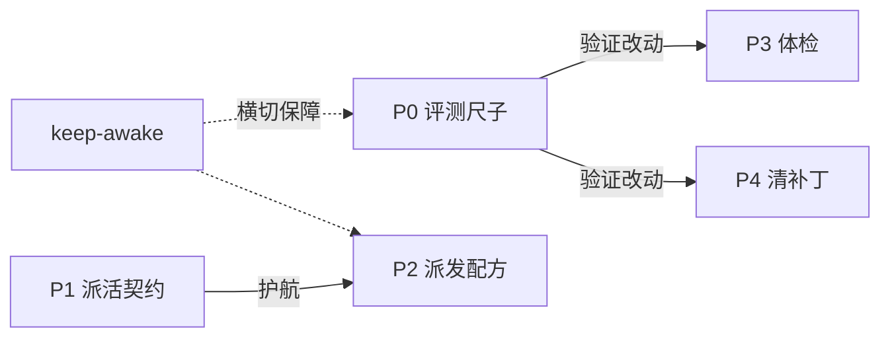

# Agent 工作流基础设施地图

> 双读者档案：上半是给人的回顾（为什么有这一套），下半是给 agent 的场景速查（何时用哪个）。细节一律以路径指针指向既有产物，本文**零复述、零新约束**——约束只住在 `.agents/rules/`。

## 缘起

2026-11，从 Anthropic《Building agents: When to fold subagents into your main agent loop》一文出发，对本仓的 agent 开发工作流做了一轮系统优化。方法论取自该文：**先度量再动架构，一次只改一件事，留得住的才保留**。优先级划分为 P0–P5；P0–P4 已全部落地（P2 为另一会话交付、事后补过一次独立评审，评审记录未入库），P5（评测 case 扩充、hillclimb、事件时间戳）留待有复测数据后按需启动。

## 五件事与咬合

| # | 一句话 | 产物入口 |
|---|---|---|
| P0 评测尺子 | 10 个 golden 任务 + rubric，回答"改规则后 agent 是更守规矩还是更绕路" | `Tools/agent-eval/workflow/` |
| keep-awake | 电源请求防 Modern Standby 冻结长任务（横切保障） | `Tools/power/`、`.agents/rules/agent-environment.md` |
| P1 派活契约 | 何时拆子代理 + 四段回执 + 主循环核验义务 | `.agents/rules/subagent-handback.md` |
| P2 派发配方 | OKF 同步链、门禁日志分诊两个已实战验证的拆分配方 | 同上「已验证派发配方」节 |
| P3 体检 | 15 个 skill 的用量审计、触发去重、log.md 归档 | `.agents/docs/skill-audit-2026-11.md` |
| P4 清补丁 | 24 文件 44 候选的旧模型规则保守清理（修 13 / 不动 31） | `.agents/docs/prompt-audit-2026-11.md` |

咬合关系：**尺子**（P0）用来验证**规矩改动**（P3/P4）没有把行为改坏；**规矩**（P1）护航**实战派活**（P2）；体检与清补丁的处置判断依赖尺子的基线读数；keep-awake 是所有长任务的物理前提。

## 跨切面教训

各特性留档（Journey log、裁决记录、规则正文）的聚合，注明出处如下——都是踩过坑换来的：

1. **先度量再动架构**——没有基线读数的改动只能靠感觉（`docs/compose/spec/workflow-golden-evals.md` S1；`skill-audit.md` S1）。
2. **盲态手法本身会泄漏**——`skip-worktree` 标志、主检出的 deleted 状态都会暴露被藏的评测材料；真盲态要让材料不在树中且被测方 cwd 不见主检出（`Tools/agent-eval/workflow/README.md`「盲态」节）。
3. **自我声明不算证据**——回执和评分同源原则：只认工具调用、产物、git 痕迹，主循环必须抽查锚点（`.agents/rules/subagent-handback.md` 回执契约；判据源头 `Tools/agent-eval/workflow/README.md` 评分规则）。
4. **跨文件"重复"多为独立加载自含性**，不是 Frankenprompt；收敛重复前先想清楚文件被单独加载的场景（`.agents/docs/prompt-audit-2026-11.md` 裁决节）。
5. **事故溯源规则 ≠ 旧模型补丁**——可裁决锚点（如"不凭记忆答版本敏感问题"是 GO-04 判据）删了会失锚；删规则前先查 `.agents/incidents/`（`.agents/docs/prompt-audit-2026-11.md` 裁决节）。
6. **506 ≠ 冻结**——Kernel-Power 506 只是进入可休眠状态；进程冻结判据是心跳连续性，真凶是"完全无活动的空闲"（`docs/compose/spec/agent-keep-awake.md` Journey log）。
7. **机械段按命令固有行为划界**，不按任务书字面禁令（`sync --write` 自动写 metadata 不算越界）（`docs/compose/spec/p2-split-pilots.md` Journey log）。
8. **契约文本要过两道筛**：真实样本试填 + 独立评审（`docs/compose/spec/subagent-handback.md` Journey log）。
9. **对既有文件的局部修改用编辑/追加**，勿整文件写入（曾覆盖掉用量数据表，靠回执复原）（`docs/compose/spec/skill-audit.md` Journey log）。

## 场景速查

| 场景 | 入口 |
|---|---|
| 改玩法 / 加技能 / 调数值 | `.agents/skills/gameplay-design-constraints/SKILL.md`（合同先行）→ `godot-csharp-development` / `godot-content-migration` |
| 派活给子代理（什么该拆、回执怎么收） | `.agents/rules/subagent-handback.md` |
| OKF 同步、门禁日志分诊（可直接照配方派） | `.agents/rules/subagent-handback.md`「已验证派发配方」＋ `.agents/rules/knowledge-maintenance.md` |
| 门禁 / 构建挂了、日志上千行 | 同上「门禁日志分诊」配方 |
| 改了 rules / skills 后想确认没改坏 | `Tools/agent-eval/workflow/README.md`（GO-01/GO-10 跑对比，基线见 `runs/baseline-2026-11-09.md`） |
| 长任务 / 离开电脑防休眠 | `Tools/power/README.md` ＋ `.agents/rules/agent-environment.md` |
| 本机工具链环境坑（dotnet / python / Godot / 子模块） | `.agents/rules/agent-environment.md` |
| 多会话并行、要不要开 worktree | `.agents/rules/agent-worktree.md` ＋ `.agents/skills/tactics-git-workspace/SKILL.md` |
| skill 用量 / 触发边界 / 死重查询 | `.agents/docs/skill-audit-2026-11.md` |
| 规则文本为什么长这样（清理与保留依据） | `.agents/docs/prompt-audit-2026-11.md` |

## 各特性详档

每件事的完整设计、验证记录与 Journey log 在各自 spec 内（`docs/compose/spec/`）：`workflow-golden-evals.md`、`agent-keep-awake.md`、`subagent-handback.md`、`p2-split-pilots.md`、`skill-audit.md`、`prompt-audit.md`。
