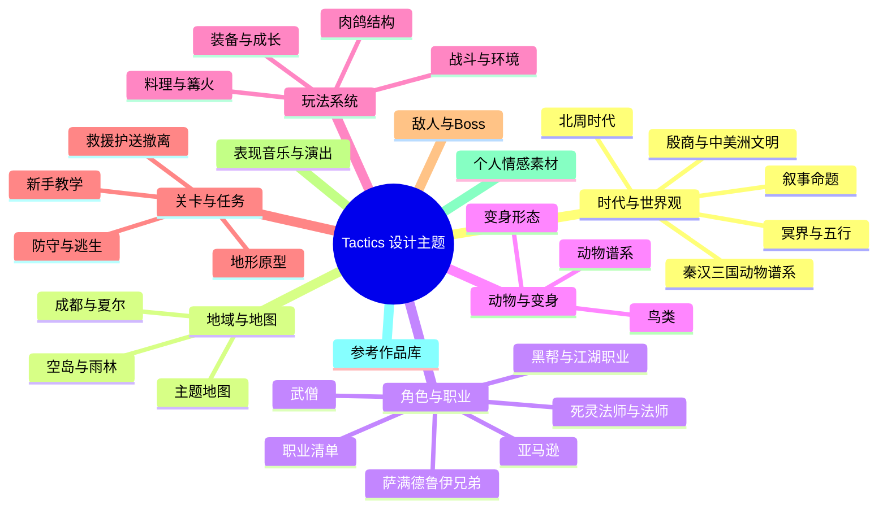

# 临时想法

## 使用约定

- 本文是未经验证的灵感收集箱，不是当前设计、已确认缺口或活跃开发计划。
- 记录在这里不代表一定实现，也不要求立即补充代码证据。
- 想法经过讨论并形成稳定设计后，迁移到对应权威设计文档；确认是现有实现缺口时，迁移到 [项目已知缺口](project-known-gaps.md)；决定执行后再建立 `.agents/plans/` 计划。
- 迁移完成的条目从本文删除，历史由 Git 保留。

### 整理流程

1. 新点子先原样追加到文末“收件箱”（日期 + 一句话）。
2. 定期把收件箱条目归类到对应设计支柱和子主题，合并重复，补上状态标签。
3. 条目形成稳定设计后标为 `[已收束]` 并附权威文档链接，随后从本文删除。

### 状态标签

| 标签 | 含义 |
|---|---|
| `[种子]` | 刚记录，尚未讨论 |
| `[讨论中]` | 正在思考或比较方案 |
| `[进行中]` | 已在开发 |
| `[已完成]` | 已实现 |
| `[已收束]` | 已迁移到权威文档（附链接，随后可删） |
| `[搁置]` | 暂不做或延后 |

条目末尾可用“关联：”指向其他支柱，方便后续串联。

## 总览

## 时代与世界观

> 深化草稿：[世界观与时代](2026-10-29-brainstorm-worldbuilding-era.md)（推荐“一个世界、三层时间”）。已定：世界以拟人动物为主，主角与反派不限物种，哺乳类、鸟类等都可以。待定：殷商与玛雅之间是什么关系；前朝“物种＝王朝”与当下物种混居如何衔接。

### 时代与历史背景

- `[讨论中]` 游戏世界的历史参照中国历史，故事发生的时代定在南北朝后期的北周（杨坚已是柱石、尚未篡位的时间点）；只借鉴，不照搬史实。
- `[种子]` 秦汉三国动物谱系作为故事中“过去的历史背景”：秦＝熊猫一族祖先，短暂统一后被哺乳类与爬行类推翻；内战中狼（汉）胜鳄（楚），大汉长期统治后军阀混战；曹操＝鹰，刘备＝马，孙权＝虎。关联：动物与变身
- `[种子]` 竹林七贤《高逸图》、苏轼或李白的取舍待定。
- `[种子]` 西晋人爱下围棋，可作为“前朝遗风”素材，例如门派传承或棋局类事件。注意：魏晋早于北周约 300 年，不能作为同时代人物出现。

### 文明与神话

- `[种子]` 尝试把殷商与玛雅文明作为不同地域、时代或镜像文明的灵感来源；暂不把两者写成同一历史体系。
- `[种子]` 中美洲文明方向候选元素：玛雅神话《波波尔乌》、被称作“诸神诞生之地”的特奥蒂瓦坎，以及金字塔建筑、黑曜石、火山、文明中的鸟类和作为冥界使者意象的美洲豹；各元素的真实文化归属待分别考证。
- `[种子]` 萨满作为人与神灵／自然连接的媒介；可可饮料可作为与神灵沟通的仪式性媒介，具体文化设定与表现方式待考证。关联：角色与职业
- `[种子]` 可对照使用“十八层地狱”等多层冥界意象，但不同文化体系之间的关系必须后续单独收束，避免直接混写。
- `[种子]` 金、木、水、火、土可作为地域、阵营、能力或世界结构的候选组织方式。
- `[种子]` 对关键历史故意不作完整记载，通过遗迹、互相矛盾的传说和角色立场让玩家自行猜测真相。

### 叙事命题

- `[种子]` “己所不欲，勿施于人”：角色与玩家最终需要面对自己施加给他人的选择。
- `[种子]` “明知不可为而为之”（孟子“虽千万人吾往矣”）：内在道义勇气，不是匹夫之勇。关联：关卡与任务（回忆闪回关卡）
- `[种子]` 《孙子兵法》“将者，智信仁勇严也”可作为指挥者／职业性格维度。关联：角色与职业

## 地域与地图

- `[种子]` 主题地图：大海、深山、平原、丘陵、黄土；参考《八方旅人》的多地图设计。
- `[种子]` 职业与地域对应：亚马逊对应雨林；法师、死灵、魔剑士对应《暗黑 2》第一幕；萨满、德鲁伊对应成都。
- `[种子]` 成都／夏尔：河狸大德鲁伊对应霍比特村庄，并收养中华田园猫；夏尔 Boss 候选为黑骑士（成都）。
- `[种子]` 空岛式区域可作为与地表隔绝的文明层，兼具探索、失落历史和垂直空间感；参考《海贼王》空岛篇，但世界观关系待重新原创。

## 角色与职业

### 职业清单

> 深化草稿：[新职业候选](2026-10-29-brainstorm-new-classes.md)。当前已实现五名候选：法师、死灵法师、亚马逊、魔剑士、诗人。建议落地顺序为野蛮人 → 料理通用系统 → 黑帮／江湖。

- `[讨论中]` 职业候选：亚马逊、死灵法师、法师、魔剑士、诗人、德鲁伊、萨满祭司、武僧；另有角斗士（百夫长神指挥）、影法术。
- `[种子]` 类似咚金刚的野蛮人：擅长破坏，平时赤手空拳，可拿场景物体做武器（石头、木棍，甚至敌人）。关联：玩法系统（环境破坏）
- `[种子]` 厨师：和休息点联动，做好吃的恢复更多；也可能不做职业而作为通用技能（人人都爱做厨师）；草稿倾向做成篝火通用系统。“我想好好打篮球”的梗可作为角色台词。关联：玩法系统（料理与篝火）
- `[种子]` 演奏家／钢琴师（未来独立职业，参考《Elin》《Elona》）：不替换已经收束的李白诗人。核心候选是演奏与曲目熟练、魅力／观众反馈、携带重型乐器带来的举重能力，以及把钢琴等乐器用于投掷的荒诞反差；战斗技能、战斗外演出收益和乐器依赖均待后续单独收束。李白诗人不再默认背古琴，具体美术修正留在对应工作区处理。
- `[种子]` “阿依阿亚帕克”猎人职业：暂按原记录保留名称，其文化来源、造型和玩法定位均待核对。
- `[种子]` 恐龙勇士方向：可以是角色、变身形态或带有悲剧英雄气质的叙事参考，暂不锁定。

### 萨满与德鲁伊

- `[种子]` 萨满／德鲁伊兄弟：大哥稳重，弟弟话痨；弟弟牺牲生命回归大自然，使哥哥完成超进化并击败魔神。此后弟弟以灵魂形态陪伴，可承担吐槽、提示与情感对话。

### 死灵法师与法师

- `[种子]` 失忆的死灵法师（原先的大 Boss）；可参考《无尽之剑》主角与 CRPG 主角。
- `[种子]` 法师想修改时间线；遗忘咒语。
- `[种子]` 重构法师，参考哈利波特守护神咒等。
- `[种子]` 死灵法师的召唤单位战后不会消失（原记录为 chore，第 2 点未写完）。
- `[种子]` 召唤骷髅的高级能力可以让玩家手动控制骷髅。

### 亚马逊

- `[种子]` 亚马逊女战士主线。
- `[已完成]` 电标马、变身女武神、远程投掷长矛、瞬移到长矛落点。

### 黑帮与江湖职业

- `[种子]` 杜月笙、高桥作为黑帮题材的人物参考，拆解其身份、行事方式与社会关系，转化为原创角色或职业灵感，不直接照搬历史人物；“高桥”的具体指代待确认。
- `[种子]` 黑帮相关职业可作为独立职业、阵营身份或NPC社会分工展开，具体职业清单与战斗定位待定。

### 武僧

- `[种子]` 武僧可以变身为“大圣”形态；触发条件、持续方式与神话背景待定。关联：动物与变身
- `[种子]` 武僧与少林寺、禅宗的关联待考证。少林寺建于北魏，与北周时代吻合；北周武帝曾灭佛，可作为武僧背景冲突。

## 动物与变身

- `[种子]` 核心动物：狼、鸮、虎、象。
- `[种子]` 鸟类作为贯穿性符号，优先考虑猫头鹰；可与青铜鸮尊、夜晚、预兆、祖先或神谕等意象关联。鸟类候选还有老鹰、隼、鸦科。
- `[种子]` 德鲁伊变身华南虎、剑齿虎；变脸与齐天大圣。
- `[种子]` 角色气质参考：《穿靴子的猫》式侠客、《黑猫警长》、绿灯侠（无畏／恐惧）；《罗小黑》能力体系待参考。

## 玩法系统

### 战斗与环境

- `[种子]` 环境破坏系统，考虑任意物体都能破坏。
- `[种子]` 环境地形：水、高台（需要攀登）、高地加成与减成（参考《博德之门 3》）。
- `[种子]` 草丛隐蔽：远距离敌人看不到草丛中的单位。这是新的可见性系统，与现有 LoS 遮挡锥（[battle-line-of-sight-rules](battle-line-of-sight-rules.md)）分开；新手教学“隐藏”段和猎人职业都依赖它。
- `[种子]` 战斗疲劳机制（待设计）。
- `[种子]` 悬赏令效果。

### 装备与成长

- `[讨论中]` 装备系统维持简化：职业限定武器和副手，避免和美术表现冲突；戒指候选如魔戒、火之戒、风之戒、水之戒。
- `[已完成]` 角色升级采用类似《英雄无敌》的模式，每个技能提供 3 档升级。
- `[种子]` 击败特定强敌后获得其能力；可用于角色成长、变身或探索权限，但能力继承范围、平衡与叙事代价待定。

### 肉鸽结构

> 深化草稿：[肉鸽节点与委托任务](2026-10-29-brainstorm-roguelike-nodes-commissions.md)。现有迷途村民护送已是跨节点任务原型，建议先接通其 Offer／Travel 生产入口，再扩展为通用委托。

- `[种子]` 把 map 切成 level，并思考肉鸽节点本质上是否就是一个 scene。
- `[进行中]` 在最小成本前提下丰富事件、休息、商店的表现：也放在 tile 地图上，有单位和特殊交互物（火堆、商人、NPC，甚至遭遇战），事件不同选项可以触发场景变化（变为战斗）。
- `[种子]` 加入 FTL 式委托任务，要求去后续特定节点完成任务（通常是战斗、护送）。
- `[搁置]` 开场选择 3 名角色，每通过一张地图可在新角色、珍贵装备或其他等价奖励之间选择；暂时还是 n 选 3 冒险。

### 料理与篝火

- `[种子]` 篝火除了休息还能做饭。关联：个人情感素材

### 内容创作

- `[已完成]` 让玩家接入 LLM BYOK 制作自己的游戏角色内容，直接复用已实现的文字需求转实现工具。

## 关卡与任务

### 地形原型

- `[种子]` 娄山关：险要隘口、登山仰攻、白刃近战，须尽快破关以免被合围。只借鉴战术结构，不照搬历史叙述。
- `[种子]` 腊子口：唯一窄桥天险、两岸绝壁，正面强攻配合侧面攀崖奇袭。
- `[种子]` 张飞长坂坡断后可作殿后／阻击关卡参考。
- `[种子]` 墓园地图中的棺材可能开出装备，也可能出现敌人僵尸。
- `[种子]` 隐藏房间是否值得加入？参考《暗黑破坏神 2》和《博德之门 3》。
- `[进行中]` 添加相机平移操作，从而支持大于屏幕的战斗地图。

### 新手教学

> 深化草稿：[新手教学](2026-10-29-brainstorm-tutorial-onboarding.md)（“公共训练＋职业试炼”，建议先做亚马逊固定序章）。

- `[种子]` 参考《蝙蝠侠：侠影之谜》中忍者联盟对布鲁斯的训练，把战斗、隐藏／潜行等能力拆成有剧情动机的新手教学，而不是脱离故事的操作说明。
- `[种子]` 新手教学主角可考虑亚马逊，与“亚马逊女战士主线”的关系待收束。关联：角色与职业（亚马逊）
- `[种子]` 后续拆解《八方旅人》的新手教程，重点研究角色开场、地图行动引导、战斗教学和系统信息的释放节奏。

### 救援、护送与撤离

- `[种子]` 回忆闪回关卡：当年老师殿后救了主角；参考《光环》致远星、《轩辕剑 3》慧彦大师、《超能勇士》恐龙勇士牺牲。关联：叙事命题
- `[种子]` 以《拯救大兵瑞恩》为原型的救援任务：穿越危险区域寻找、确认并带回特定人物；代价与“是否值得救”可成为队伍冲突。
- `[种子]` 参考《魔戒 1》波洛米尔的护送任务：被护送者有自己的意志、弱点和关键抉择，而不是只会跟随的任务物体。
- `[种子]` 参考《泰坦尼克号》的限时灾难撤离：空间持续失效，玩家必须决定救谁、放弃什么，以及如何分配有限通路或载具。
- `[种子]` 把小金做成任务，寻狗启示类。

### 防守与逃生

- `[种子]` 防御式战棋关卡。
- `[种子]` 类似《英雄无敌 3》中敌方英雄回来追击玩家的逃生体验。

## 敌人与 Boss

- `[种子]` 第一个最小 Pure Run 的最终 Boss：借鉴《空洞骑士》螳螂领主的 Boss 战，原型替换为猛禽“游隼领主”。可借鉴的要点包括：先单挑、后多人围攻的阶段结构；以礼相待的决斗气质，战败后会认可主角；高速突进和俯冲的读招节奏。游隼的俯冲速度可转化为直线长距离突袭。关联：动物与变身（鸟类）
- `[种子]` 参考希斯·莱杰版小丑的 Boss。
- `[种子]` 巨大化 Boss。
- `[种子]` 大沙暴 Boss、深海大鱿鱼 Boss。

## 表现、音乐与演出

### 演出

- `[种子]` 开宝箱时使用类似《暗黑破坏神》的金币和装备弹出效果。
- `[种子]` 战斗内的气泡文字聊天。
- `[种子]` 类似《圣斗士星矢》的变身演出。
- `[种子]` 启动 splash 界面仿照米高梅影业狮子吼叫的动效（改成狗叫）。
- `[搁置]` 事件属性检定的《博德之门 3》式投骰演出，展示检定角色、成功率、骰子结果和结算。

### 叙事桥段

- `[种子]` 角色回到过去与父亲对话，重点不是改变历史，而是重新理解父辈或完成告别；参考《泽塔奥特曼》。关联：个人情感素材
- `[种子]` 大战转折：败局中收到神灵指引，由百夫长／指挥者重整阵线逆转战局；保留人物决策，避免神谕直接替角色解决问题。

### 音乐

- `[种子]` 重要配乐从一段短旋律逐步叠加为完整主题曲，让角色、文明或 Boss 拥有可辨识的动机；制作方法参考[《一段旋律怎么变成一首歌？曝光学生党制作歌曲全过程 :)》](https://b23.tv/FGOPICQ)，氛围强度参考诺兰《蝙蝠侠》。
- `[种子]` 曲目与文化意象：梁祝、《清平调》、女儿情。

## 个人情感素材

- `[种子]` 父亲做菜的回忆；我喝咖啡的源头也是父亲。
- `[种子]` 爷爷小时候想让我当医生，后悔没做；长大后“回去救他”的可能（对应《流人》里 river 与爷爷）。
- `[种子]` 台词：“只要他等我回家，就会留一盏灯，就一盏。”（Whenever he'd be expecting me, he'd leave a light on. Just one.）
- `[种子]` 食物与文化符号：兔肉、蹄花汤、冒菜、蛋烘糕、肥肠粉、盖碗茶、熊猫苹果／苹果酒、小熊猫。

## 参考作品库

| 借鉴什么 | 作品 |
|---|---|
| 核心战斗 | 《喵喵的结合》、《幻世录》、咚金刚、明日方舟 |
| 职业和故事背景 | 《暗黑破坏神 2》 |
| 美术风格 | 《Kingdom Rush》、逃离鸭科夫 |
| 定期村庄防守 | 《最后的咒语》 |
| 城镇建造（待定） | 《球比伦战记》、《英雄无敌 3》 |
| 外出肉鸽 | 《喵喵的结合》、《杀戮尖塔》、FTL |
| 文明与神话氛围 | 殷商、玛雅、《波波尔乌》、特奥蒂瓦坎；【少司命】《青铜鸮尊》MV（“千年前的妇好将军，会对我说什么呢？”） |
| 音乐氛围 | 诺兰《蝙蝠侠》配乐 |
| 大场面与叙事 | 《星球大战》、《海贼王》空岛篇、《魔戒 1》波洛米尔、《复仇者联盟 4》、《拯救大兵瑞恩》、《泰坦尼克号》、《泽塔奥特曼》、《角斗士》 |

## 收件箱

（空）
